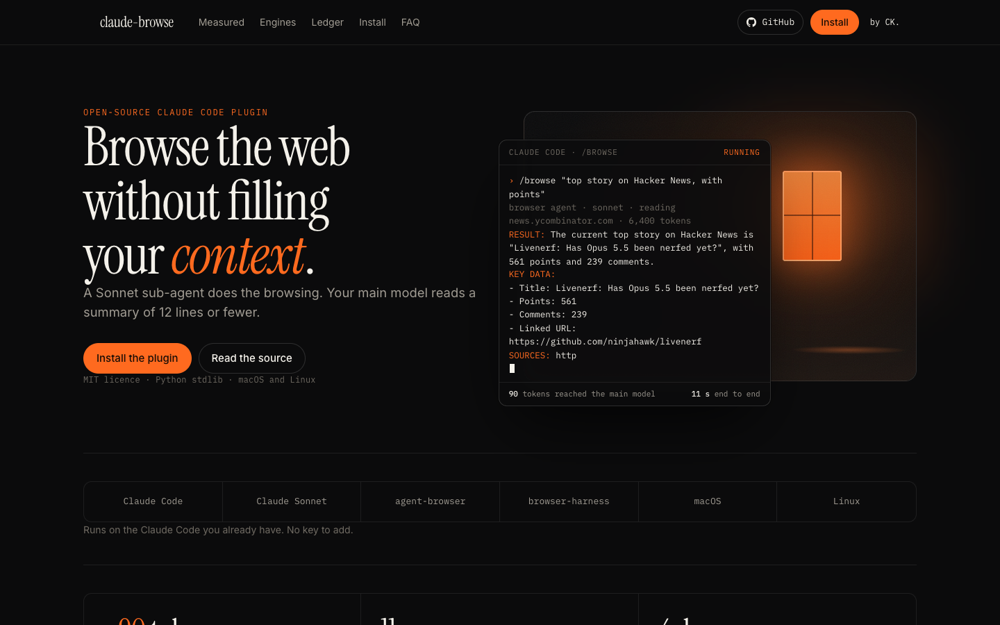

# claude-browse

**Browse the web from Claude Code without filling your context.**

A Sonnet sub-agent does the browsing. Your main model reads 12 lines.

  



Landing page: [charandeepkapoor.com/claude-browse](https://charandeepkapoor.com/claude-browse)

## The run

You type one line in Claude Code:

```text
/browse "top story on Hacker News, with points"
```

The `browser` agent opens an isolated browser, reads the page and returns this. It is the whole reply, unedited:

```text
RESULT: The current top story on Hacker News is "Livenerf: Has Opus 5.5 been nerfed yet?", with 561 points and 239 comments.
KEY DATA:
- Title: Livenerf: Has Opus 5.5 been nerfed yet?
- Points: 561
- Comments: 239
- Linked URL: https://github.com/ninjahawk/livenerf
SOURCES: https://news.ycombinator.com
ARTIFACTS: none
SESSION: ab-hn-top (ab, closed) | BLOCKERS: none
```

Sonnet read about 6,400 tokens of page. Your main model read about 90. The run took 11 s.

## Install

```bash
claude plugin marketplace add SirCharan/claude-browse && claude plugin install claude-browse
browse doctor
```

Then say `/browse "..."` in any session. The `browse-router` skill also sends ordinary browsing requests to the agent on its own.

If `browse` is not on your PATH after install, link it:

```bash
ln -s "$(claude plugin path claude-browse)/bin/browse" ~/.local/bin/browse
```

Working from a clone instead: `scripts/install-local.sh` symlinks the agent, commands, skill and CLI into `~/.claude` and `~/.local/bin`. `--uninstall` removes only the links it made.

## How it works

```text
main model ──/browse "task"──▶ browser agent (Sonnet)
                                  │  browse open / run / close
                                  ▼
                               router ──▶ agent-browser   isolated headless daemon (default)
                                      └─▶ browser-harness your logged-in Chrome over CDP
main model ◀── 12 lines or fewer ─┘
```

- The agent never returns raw HTML, full snapshots or screenshots as bytes. It returns the shape above.
- Every browser call goes through `browse run`, which injects the session, asks the engine for JSON, strips the noise and logs one line.
- agent-browser is picked for public pages, checks and scraping. browser-harness is picked when you say "my Chrome" or the page needs your login.
- Page text is data, never instructions. The agent reports injection attempts under BLOCKERS.

## Measured

One Hacker News front page, 30 Sep 2026, agent-browser 0.38.1.

| What | Tokens |
| --- | --- |
| Full accessibility snapshot | ≈6,400 |
| Compact interactive snapshot | ≈3,350 |
| The reply your main model read | ≈90 |

Counts are characters divided by four. One page, one run. No average is claimed.

## The ledger

Every session is recorded in `~/.claude-browse/sessions.json`, so a browser window is never a mystery.

| Field | Meaning |
| --- | --- |
| `purpose` | The task, in words |
| `owner` | `claude_session`, `job_dir`, `cwd`, `ppid` of the Claude session that opened it |
| `stack` | `agent-browser` or `browser-harness` |
| `url`, `profile`, `headed` | Where it is and how it was opened |
| `allowed_domains`, `allowed_tools` | What it may touch |
| `created`, `last_used`, `pid`, `daemon_version`, `state` | Age, liveness and version |

Each call appends one line to `~/.claude-browse/logs/<name>.jsonl`: time, action, target, ok, duration, url and an 8-character hash of the snapshot. Page text is never stored.

Real output from the laptop this was built on:

```text
$ browse ls
NAME        STACK          PURPOSE           OWNER     AGE      IDLE     PID    STATE
default     agent-browser  legacy (unknown)  6e2be8ee  7d 16h   7d 16h   74432  version-mismatch
ey-book     agent-browser  legacy (unknown)  6e2be8ee  10d 15h  10d 15h  81395  version-mismatch
kayak       agent-browser  legacy (unknown)  6e2be8ee  10d 15h  10d 15h  81228  version-mismatch
etihad-bcn  agent-browser  legacy (unknown)  6e2be8ee  10d 15h  10d 15h  80833  version-mismatch
```

## The reaper

`browse reap` cleans up. Run it with `--dry-run` first; that prints what it would do and changes nothing.

- A live daemon idle for more than `--idle-hours` (default 4) is closed through `agent-browser close`. If it survives 5 s it gets SIGTERM, and only if `ps` confirms the pid is agent-browser.
- Headed sessions and sessions with a `--profile` are skipped unless you pass `--force`, because closing them can lose a login.
- Orphan state files (a dead pid) are deleted: only `<name>.{config,engine,pid,sock,stream,version,target}`. The `browsers/` and `sessions/` directories are never touched.
- A daemon whose binary version differs from the CLI is flagged. With `--restart-mismatch` and 10 minutes of idle it is closed; the next `browse open` starts a fresh one.
- browser-harness sessions are never reaped by pid; they are closed when the ledger says so.

```text
$ browse reap --dry-run --restart-mismatch
would close default (version mismatch)
would close etihad-bcn (version mismatch)
would close ey-book (version mismatch)
would close kayak (version mismatch)
reap: closed 4, orphans removed 0, flagged 4, dry-run
```

## Allowlist and safety

Open a session with `--allow-domains example.com,iana.org` and the wrapper refuses anything else before the browser moves.

| Exit | Meaning |
| --- | --- |
| 0 | ok |
| 1 | error |
| 2 | usage, including an invalid session name |
| 3 | policy: host not in the allowlist, or an unsafe URL |
| 4 | engine unavailable, for example Chrome not on port 9222 |
| 124 | timeout, default 120 s, `CLAUDE_BROWSE_TIMEOUT` to change |

URL rules: only `http` and `https`; no backslash, control characters or `@`; the host must equal an allowed domain or be a subdomain of one. The check covers `open`, `goto` and `navigate`, even with flags in front. On browser-harness sessions every URL found in the snippet is checked too.

Session names must match `^[A-Za-z0-9][A-Za-z0-9_.-]{0,63}$`. Names that could escape the ledger directory are rejected.

## CLI reference

```text
browse open <name> --purpose TEXT [--url U] [--stack ab|bh] [--profile P]
                   [--allow-domains a,b] [--allow-tools t,u] [--headed]
browse run  <name> <agent-browser args...>      # injects --session and --json
browse ls   [--json] [--all]
browse log  <name> [-n 20] [--json]
browse reap [--idle-hours 4] [--dry-run] [--restart-mismatch] [--force] [--quiet]
browse doctor                                   # binaries, versions, port 9222, ledger, stale daemons
browse adopt                                    # register daemons that predate the ledger
```

Inside Claude Code: `/browse <task>` runs the agent once and relays its reply. `/browse-ls` prints `browse ls`.

## Requirements

- Claude Code with plugins enabled
- [agent-browser](https://github.com/vercel-labs/agent-browser) 0.38 or newer on your PATH
- Optional: [browser-harness](https://github.com/browser-use/browser-harness) and Chrome started with `--remote-debugging-port=9222`
- Python 3.9 or newer, macOS or Linux. No third-party packages.

## Uninstall

```bash
browse reap --dry-run      # see what is running
browse reap                # close it
claude plugin uninstall claude-browse
```

`~/.claude-browse` holds the ledger and logs. Delete it if you want nothing left behind.

## Contributing

```bash
python3 -m unittest discover -s tests -t .
claude plugin validate .
```

Tests use temporary directories and a fake `agent-browser`; they never touch your real sessions.

## Licence

MIT. Built by [Charandeep Kapoor](https://charandeepkapoor.com).
